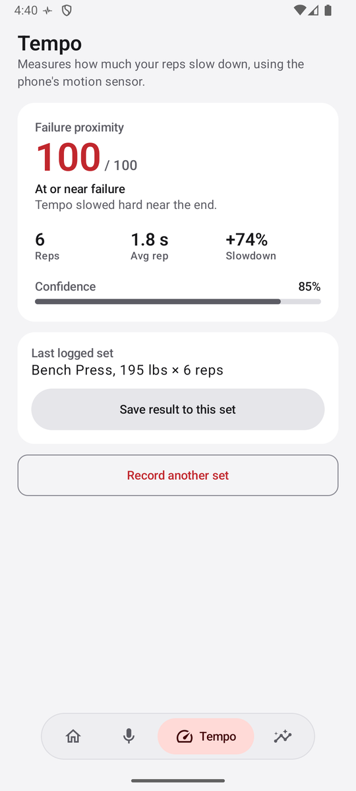
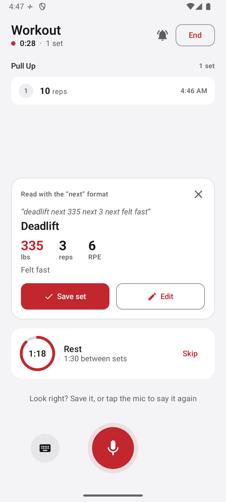
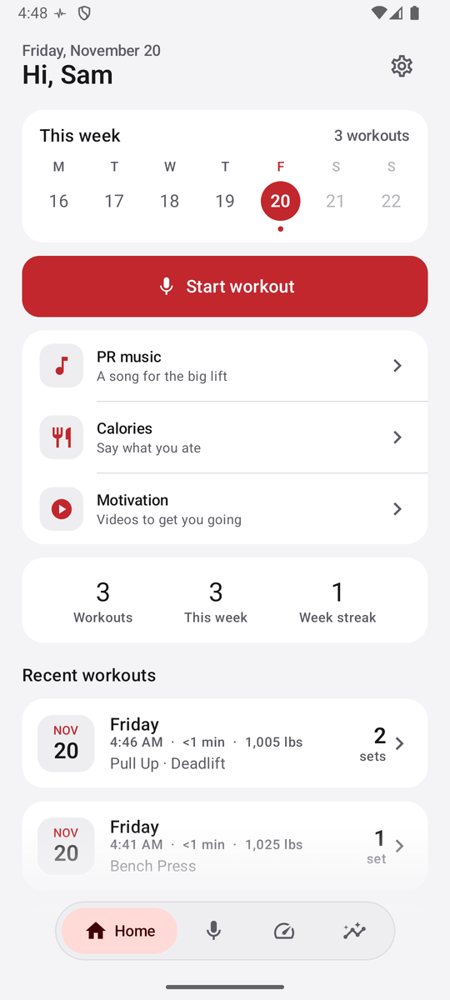
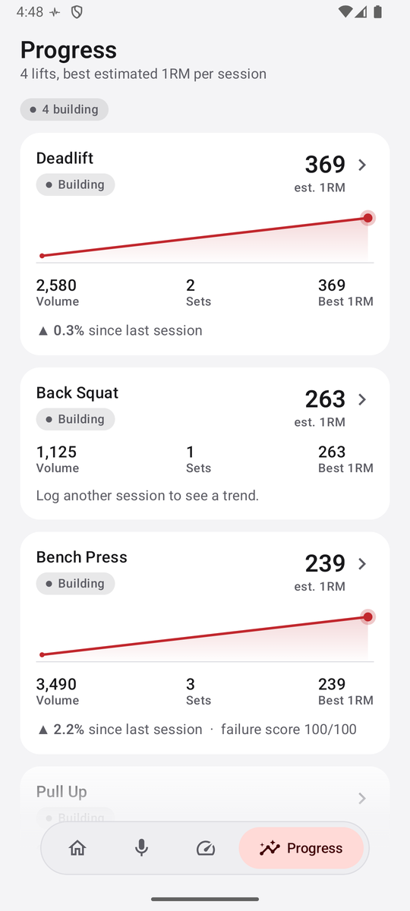
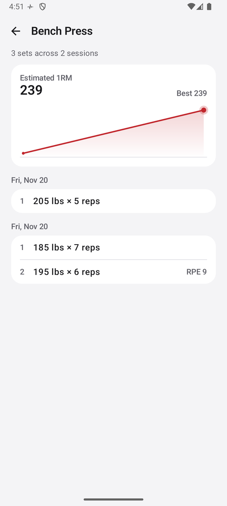
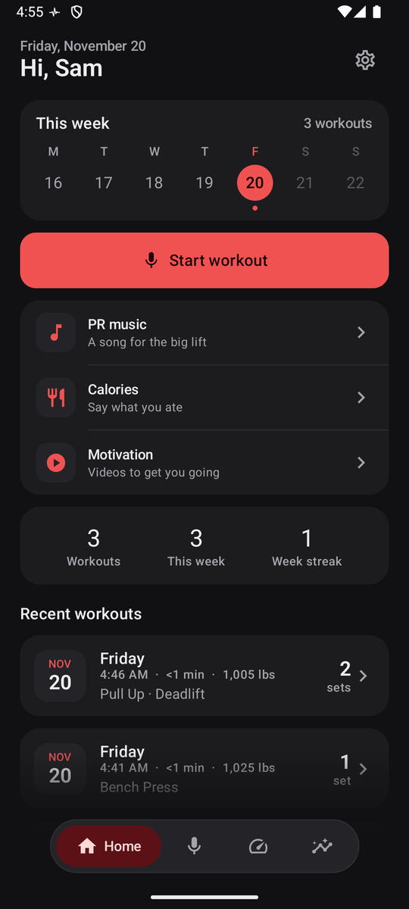

# Redline

An Android training app that listens and feels. Log a set by talking during your rest, and let the phone's accelerometer tell you how close the last set actually came to failure.

Native Kotlin and Jetpack Compose. Roughly 7,100 lines across 53 files. Hilt, Room, Material 3, Navigation-Compose, MVVM.

| Tempo analysis | Logging a set by voice | Home |
|---|---|---|
|  |  |  |

---

## The idea

Two things break workout logging. You cannot type with chalk on your hands, and "how hard was that set" is a number people guess at badly.

So: speech goes in and structured sets come out, and rep tempo gets measured off the accelerometer instead of self-reported. Everything is local. Nothing needs an account.

## What it does

- **Train.** Start a workout, say a set, check the parsed card, save. Or type it with the keyboard button. Tap any logged set to fix its exercise, weight, reps, RPE or notes. A rest timer starts after each saved set, and a workout that ends with no sets is discarded rather than saved.
- **Tempo.** Record a set with the phone on you, get a failure-proximity score, and attach it to the last logged set.
- **Progress.** One card per lift with an estimated-1RM trend and a status: Building, Progressing, Stagnating or Regressing. Bodyweight lifts with no load, like pull-ups, are tracked by reps instead. Tap a lift for its full history.
- **Home.** This week at a glance, recent workouts, and links to PR music, calorie lookup and motivation videos.
- **Settings.** Name, weight unit, rest length, the optional parser endpoint (with a Test button that says why it failed), and the optional USDA key.

Light and dark themes share one set of colour tokens, and a unit test holds every text pairing to WCAG AA.

---

## What makes it interesting technically

### Voice parsing degrades in three tiers, and works offline

`VoiceParser.parse()` hands the transcript to `SetParsePipeline`, which has no Android or Hilt dependencies so tests can drive it with fakes. It tries three strategies in order, each gated on a confidence threshold:

1. **Separator parse.** The structured format is `"{exercise} next {weight} next {reps} [next {notes}]"`. Splitting on a spoken separator and parsing each segment independently is far more reliable than parsing freeform speech, so this runs first and short-circuits at confidence ≥ 0.60.
2. **Remote LLM parse.** If a user has configured an endpoint in Settings, `RemoteVoiceParser` POSTs `{schemaVersion, transcript}` and expects back a typed object with `exerciseName`, `canonicalExerciseKey`, `weight`, `unit`, `reps`, `rpe`, `notes`, `confidence`, and `needsClarification`. Accepted at confidence ≥ 0.55 and only when `needsClarification` is false. Any failure returns null, so a dead endpoint costs one connect timeout (4 s), not a crash. The Settings **Test endpoint** button runs the same request and says what went wrong: nothing listening, host not found, no answer in time, or a response that doesn't fit the schema.
3. **Local freeform regex.** Compiled patterns with lookaround guards handle explicit units (`225 lbs`), prepositional weights (`at 225`), reps after `for`/`x`, RPE, and bare numbers, plus keyword lists that infer effort from words like "grind", "barely", "flew up".

The important property is the ordering. The LLM sits in the **middle**, not at the front and not as a hard dependency. With no endpoint configured, the app is fully functional on-device. The model is an accelerator for messy input, not the thing that makes logging work.

Parsed exercise names go through `ExerciseCatalog` to a canonical key, so "incline dumbbell press", "incline db press", and "incline press" all land on one row in the progress history.

### Tempo analysis is motion, not audio

`TempoRecorder` registers for `TYPE_LINEAR_ACCELERATION`, falling back to `TYPE_ACCELEROMETER` on devices without it, at `SENSOR_DELAY_GAME`. Each event becomes a `TempoSample` of `(timestampNs, sqrt(x² + y² + z²))`.

`TempoAnalyzer` then does the actual work:

- **Smoothing.** A 3-sample moving average, because raw accelerometer magnitude is noisy enough to produce phantom peaks.
- **Adaptive threshold.** `mean + max(0.18, 0.75 × stddev)`. Fixed thresholds fail across the range from a light warm-up to a heavy grind; scaling to the set's own variance does not.
- **Peak picking with a refractory window.** Local maxima above threshold, with a 450 ms minimum gap so one rep's acceleration and deceleration do not register as two reps.
- **Interval filtering.** Peak-to-peak intervals outside 0.35s to 8s are discarded as noise or as rack time.
- **Degradation.** Compare the mean interval of the first third of reps against the last third. Rep time growing across a set is the physical signature of approaching failure, and it is measured rather than asked about.
- **A failure-proximity score** banded off that degradation percentage, plus a confidence value that scales with how many usable intervals were found.

Every failure path returns a typed reason instead of a plausible-looking number: `"Not enough movement data"`, `"Movement was too subtle to score"`, `"Rep timing was inconsistent"`, each with confidence at or near zero. A tempo analyser that always answers is a tempo analyser that lies.

A scored result can be saved onto the last logged set. The score then shows in that set's row and on the lift's Progress card.

### Tests

61 JVM unit tests, run with `./gradlew testDebugUnitTest`:

- `TempoAnalyzerTest`: steady vs slowing tempo, and each failure path.
- `LocalSetParserTest`, `SetParsePipelineTest`, `SetDraftTest`, `ExerciseCatalogTest`: the separator and freeform parsers, tier ordering and fallback with a fake remote, editing a parsed set, and exercise aliases.
- `ProgressSummaryTest`, `FormatTest`, `LinkValidationTest`: progress trends and stall detection, duration and number formatting, and music/video link checks.
- `ColorContrastTest`: WCAG contrast for every text and icon pairing in both themes.

### The permission surface is handled on purpose

Four sensitive grants, each with a rationale flow rather than a cold system prompt:

- `RECORD_AUDIO` for Android's on-device `SpeechRecognizer`. Audio never leaves the phone; only the transcript string does, and only if you configured a remote parser endpoint.
- `ACCESS_NOTIFICATION_POLICY`, so `DndManager` can set `INTERRUPTION_FILTER_NONE` when a workout starts and restore `INTERRUPTION_FILTER_ALL` when it ends. It checks `isNotificationPolicyAccessGranted` before every call and no-ops without it, and it can deep-link straight to the right settings page.
- `VIBRATE` for set and rest feedback.
- `INTERNET` only for the optional USDA nutrition lookup and the optional remote parser.

### Architecture

Clean MVVM with no shortcuts. Room database at schema version 3 with five entities (`WorkoutSession`, `ExerciseSet`, `PrTrack`, `MotivationalVideo`, `CalorieEntry`) behind a single `WorkoutDao`, wrapped by `WorkoutRepository`, injected into ViewModels by Hilt with KSP-generated components. Navigation-Compose with 10 routes including two parameterised ones (workout detail by session id, exercise history by canonical key, URL-encoded). Home, Train, Tempo and Progress sit in a floating pill bar; Music, Calories, Motivation and Settings open from Home. Coroutines and `StateFlow` throughout; the sensor recorder exposes a sealed `TempoState` of `Idle | Recording | Ready | Error` rather than a bag of nullable fields.

Nutrition lookups hit USDA FoodData Central with a key the user supplies in Settings. Blank key means the feature returns an empty list rather than throwing.

---

## Stack

Kotlin, Jetpack Compose with Material 3, Hilt with KSP, Room, Navigation-Compose, Coroutines and Flow, Android `SpeechRecognizer`, `SensorManager`, Gradle Kotlin DSL with a version catalog. `minSdk 26`, `targetSdk 34`, JVM target 17, R8 minification on release.

---

## Run it

**Android Studio:** open the project folder, let Gradle sync, hit Run with a device connected over USB debugging.

**Command line:**

```bash
./gradlew assembleDebug      # macOS / Linux
gradlew.bat assembleDebug    # Windows
./gradlew installDebug       # to a connected device
./gradlew testDebugUnitTest  # unit tests
./gradlew assembleDemo       # release speed plus the demo hooks, for screen recordings
```

Requires JDK 17 and the Android SDK with `ANDROID_HOME` set. The APK lands in `app/build/outputs/apk/debug/`.

**Recording a demo:** the `demo` build is R8-minified and not debuggable, so animations run at release speed, and it keeps the debug-only `DemoSpeechReceiver`. An emulator has no microphone, so the receiver feeds a transcript through the same states a real recognition produces, and the parser, UI and database handle it as usual. Arm it, then tap the mic:

```bash
adb shell am broadcast -n com.redline.app/.demo.DemoSpeechReceiver \
    -a com.redline.app.DEMO_SPEECH --ez arm true --es text "bench 185 for 8 RPE 8"
```

It is signed with the debug key, so it installs over a debug build and keeps its data.

**Testing a parser endpoint locally:** debug builds allow cleartext HTTP, so an endpoint on your computer works from the emulator at `http://10.0.2.2:<port>/parse`. Release builds stay HTTPS-only.

**First run on the phone:** grant the microphone permission when prompted, and grant notification-policy access from Settings if you want the do-not-disturb toggle to work. Two optional API keys go in the in-app Settings screen: a USDA FoodData Central key for calorie lookups, and an LLM endpoint URL for the remote voice parser. Without them, voice logging runs fully on-device and the Calories screen says a key is needed and links to Settings.

---

## Layout

```
app/src/main/java/com/redline/app/
  data/local/           Room database (v3), 5 entities, WorkoutDao
  data/repository/      WorkoutRepository
  di/                   Hilt module
  voice/                SpeechRecognizerManager, VoiceParser, SetParsePipeline,
                        LocalSetParser, RemoteVoiceParser, ExerciseCatalog, SetDraft
  tempo/                TempoRecorder (sensor), TempoAnalyzer (the maths)
  nutrition/            USDA FoodData Central client
  settings/             SettingsStore
  util/                 DndManager
  ui/                   home, log, tempo, progress, calories, music, motivation,
                        settings, workout (detail and exercise history),
                        navigation, theme, components
app/src/test/           voice, tempo and UI-logic unit tests (61)
app/src/debug/          DemoSpeechReceiver, cleartext HTTP (debug and demo builds only)
```

---

## Honest state

Version 0.1.0. It builds, installs, and runs. What is not finished:

- **No UI or instrumented tests.** The 61 tests cover parsing, tempo maths, progress logic, formatting and colour contrast on the JVM. Screens were checked by hand on an emulator.
- **Tempo is not yet calibrated on a body.** The analyser is unit-tested and the full record, score and save flow works, but the emulator checks fed it simulated sensor data. It still needs real sets in a pocket or armband to tune the score bands.
- **`MusicController` is one `ACTION_VIEW` intent.** It hands a stored track URI to whatever app claims it. There is no playback integration, no Spotify SDK, no now-playing state.
- **The remote voice parser expects an endpoint you provide.** There is no hosted service, and the request schema (`schemaVersion: 1`) is defined by this app rather than by any standard.
- **No release signing config, no Play listing.** Debug builds only so far.

---

## Screenshots

| Progress | Exercise history | Dark theme |
|---|---|---|
|  |  |  |

Captured on an Android emulator (API 35). The voice transcripts came from the demo hook above and the tempo set from simulated sensor input, so the numbers show the real parser and analyser at work but not a real lift.

Still worth adding from a real phone: **`tempo-demo.mp4`**, 15 seconds of the phone in a pocket or armband through three or four reps, then the analysis appearing.
